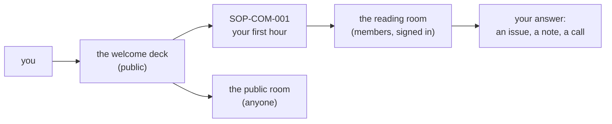

<!-- AUTO-GENERATED MIRROR — do not edit this file directly.
     Source of truth: https://github.com/theholyearthfoundation/.github/blob/main/profile/README.md
     This copy refreshes hourly via .github/workflows/mirror-profile-readme.yml -->

<picture>
  <source media="(prefers-color-scheme: dark)" srcset="https://raw.githubusercontent.com/theholyearthfoundation/.github/main/profile/assets/banner-dark.svg">
  
</picture>

# The Holy Earth Foundation

*Its source: Jesus and the Holy Spirit · its founder and project lead: Isaiah (Kenney)*

&nbsp;

 

---

 The Holy Earth Foundation bridges **A Course in Miracles** (The Eagle) with **Plant Medicine
traditions** (The Condor) in a teaching called **Plants & Miracles** — where the two come together as
one, symbolized by the Barn Owl's single-mindedness. Currently expressed through two projects:

-  **[I Am One Self](https://www.iamoneself.com)** — Kenney's teaching, background, and the
  Plants & Miracles philosophy.
-  **[I Am One Self Retreats](https://retreats.iamoneself.com)** — retreats and spiritual coaching,
  teaching Plants & Miracles through an interactive site.
-  **[David Amaringo](https://david.iamoneself.com/)** — a home for
  Maestro David Amaringo, an Ayahuasca visionary artist trained by his uncle Pablo Cesar Amaringo Shuña
  (founder of the USKO-AYAR Amazonian School of Painting), a co-founder of Chaiconi Bari, and lead
  retreat facilitator alongside Kenney.

##  About this page

This organization's GitHub presence, and its formal incorporation, are both still coming together —
this profile is an honest early draft, not a finished institutional page. It exists now mainly so the
org's public repos (starting with this one) have a real home instead of an empty search result.

##  Explore

-  [Org root page →](https://theholyearthfoundation.github.io)
-  [Changelog →](https://theholyearthfoundation.github.io/changelog-astro-public/changelog):
  a running, plain-language record of what's actually shipped.
-  [Library →](https://theholyearthfoundation.github.io/changelog-astro-public/library): deeper
  technical write-ups behind it.
-  [I Am One Self.com →](https://www.iamoneself.com)
-  [I Am One Self Retreats →](https://retreats.iamoneself.com): live, published to
  [`iamoneself-retreats-public`](https://github.com/theholyearthfoundation/iamoneself-retreats-public).
-  [David Amaringo →](https://david.iamoneself.com): live, published to
  [`david-amaringo-public`](https://github.com/theholyearthfoundation/david-amaringo-public).
-  **The first lab versions, kept as they were** (each one's note steps forward to today):
  [I Am One Self](https://drasticstatic.github.io/iamoneself-public-preview/) · [David Amaringo](https://drasticstatic.github.io/david-amaringo-public-preview/).

##  New here? Start with the welcome

<a href="https://github.com/theholyearthfoundation/.github/blob/main/decks/welcome.marp.pdf"> <b>Welcome to The Holy Earth Foundation</b></a>: seven stops for a newcomer and the AI helper beside them
(your first hour, five words, proposals, procedures, the reading room, how a change travels, how to answer).
Also as [slides](https://github.com/theholyearthfoundation/.github/blob/main/decks/welcome.marp.html) and
[markdown](https://github.com/theholyearthfoundation/.github/blob/main/decks/welcome.marp.md); every deck anyone may
read is on the [decks shelf](https://github.com/theholyearthfoundation/.github/tree/main/decks).

##  Proposals, procedures and decks

| | Where | What you find |
|---|---|---|
|  | [**The reading room**](https://github.com/theholyearthfoundation/reading-room) (members, signed in) | the proposals, procedures and decks the foundation's people read before they are public, each as a page and a PDF. A 404 means "not yet invited" or "signed out", not "broken" |
|  | [**The public room**](https://theholyearthfoundation.github.io/reading-room-public/) (anyone) | what an officer has opened to visitors; its front page links back to the members' room |
|  | [**Procedures**](https://github.com/theholyearthfoundation/ops-standard-operating-procedures-public) (public twin) | *this is how we do it now*: the procedures every organisation shares, step by step, each with a PDF (filled by its sync; members read the full set in the reading room) |
|  | **SOP-COM-001**, *New to GitHub: your first hour* | your own account and password, two-factor, the invitation, five words, the reading room, a helper: [in the reading room](https://github.com/theholyearthfoundation/reading-room/blob/main/procedures/COM/SOP-COM-001-new-to-github-your-first-hour.md) |
|  | [**Decks**](https://github.com/theholyearthfoundation/.github/tree/main/decks) | the welcome deck; Kenney's *Home base* lives in the members' room |
|  | [`proposals`](https://github.com/theholyearthfoundation/proposals) and [`ops-standard-operating-procedures`](https://github.com/theholyearthfoundation/ops-standard-operating-procedures) (members) | where proposals ask and procedures are written |
|  | [**Gitmoji**](https://github.com/drasticstatic/my-template/blob/main/GITMOJI.md) | every commit subject starts with one gitmoji and a type: `:memo: docs(sop): …` |

##  Community health

- [`ONBOARDING.md`](https://github.com/theholyearthfoundation/.github/blob/main/ONBOARDING.md): **joined the organization? start here**: two-factor login, connecting your AI helper, and how we work
- [`CONTRIBUTING.md`](https://github.com/theholyearthfoundation/.github/blob/main/CONTRIBUTING.md): how to contribute, and the [Gitmoji](https://github.com/drasticstatic/my-template/blob/main/GITMOJI.md) every commit subject starts with
- [`SECURITY.md`](https://github.com/theholyearthfoundation/.github/blob/main/SECURITY.md)
- [`SOCIAL-PREVIEWS.md`](https://github.com/theholyearthfoundation/.github/blob/main/SOCIAL-PREVIEWS.md): how to refresh link previews in Telegram, LinkedIn, Facebook and more, and which pages have their own share image

##  License
-  **Code:** MIT, see [`LICENSE`](https://github.com/theholyearthfoundation/.github/blob/main/LICENSE)
-  **Written content** (docs, changelog and library prose, READMEs): CC BY-SA 4.0, see [`LICENSE-CONTENT`](https://github.com/theholyearthfoundation/.github/blob/main/LICENSE-CONTENT)
-  **Names, logos and marks:** not covered by either license, see [`TRADEMARKS.md`](https://github.com/theholyearthfoundation/.github/blob/main/TRADEMARKS.md)

---

~ A small note from Alfred, the agent who established this:

 
Kenney,
<em>Welcome to GitHub. What you see here so far is gathered from what Christopher and your own project
READMEs already say about the work, so it's guaranteed to have gaps — you're the one who actually
knows this teaching, this lineage, and the foundation — whenever you're ready, I am eager to
help you continue building.</em>
